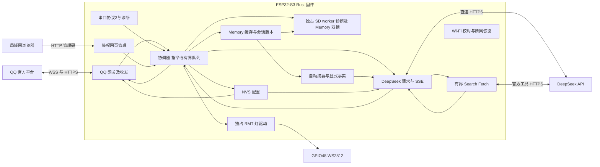

# Rust ESP32 QQBot DeepSeek 固件设计与实施记录

日期：2026-10-20。目标板：GOOUUU ESP32-S3-CAM，N16R8。已部署的 v0.2.0 r3 提供历史回归基线；v0.3.0 已刷入目标板并完成 SD Memory、自动摘要、重启恢复、三种语言和诊断图片 OCR 的实机测试。异常清理超时分支、完整 QQ 检索问答及长期稳定性仍待验收。

ESP 独立完成 QQ 收发、DeepSeek 请求、短会话和板载灯控。新应用从零编写 Rust 业务代码，复用 ESP-IDF 基础驱动及 TLS；不引入旧 ESP-Claw 运行时或其他 agent 项目。独立工程已交叉编译并刷入目标板，以下区分实现设计和实际验收结果。

## 范围与版本扩展

首版支持 QQ 官方 Bot 单聊和群内被提及后的文字问答、DeepSeek API、允许名单、短会话、状态查询与确定性灯控。OpenAI、订阅授权、代理、通用 agent 框架、Lua、MCP、定时任务、摄像头和语音均退出当前范围。

v0.2.0 按用户要求增加局域网网页管理、可选 SD 挂载与读写检查，以及 DeepSeek 自家 Search/Fetch 接口。网页、SD 和联网检索分别拥有有界入口；普通对话不隐式联网，SD 不承载必要配置，聊天仍不依赖卡的可用性。该版本只写 Boot 类型的固定格式诊断日志，聊天历史在 RAM；v0.3.0 经用户明确授权增加独立 Memory 格式，不复用或迁移旧工程会话。

新工程位于 application/qq_deepseek_rust，与旧 C 工程隔离。旧工程及备份作为硬件资料和恢复依据，只迁移经过校验的配置字段；不直接复用旧会话索引、文件布局、动态板级管理器或 agent loop。

“从零”指应用状态机、资源所有权、配置格式和业务逻辑自己实现。Wi-Fi、FreeRTOS、lwIP、TLS、NVS 和 RMT 使用 SDK 基础设施。Rust 可以减少内存和并发错误，错误引脚、供电不稳、SD 文件系统损坏及 SDK 故障仍须靠实机验收发现。

## v0.3.0 Memory、身份和图片输入

用户已明确授权将会话记忆写入 SD，取代 v0.2.0 的 RAM-only 限制。新目录固定为 /sdcard/qq-deepseek/memory/，Boot 诊断日志仍只含固定事件与数字时间；不触碰旧会话、不把记忆写入 NVS 或普通日志。助手自称 CopilotLee，AI 回答随用户最近的原始自然语言输入，管理页仍中文；网页、OCR、图片、URL 和记忆包装不能改变系统策略或强制语言。

Memory 分为明确事实、滚动摘要和最近完整问答。最多 32 个持久会话，单记录 JSON 48 KiB；事实最多 16 条且每条 512 UTF-8 字节，摘要最多 4 KiB，最近最多 8 轮／32 KiB。RAM 文字缓存预算为 48 KiB，LRU 淘汰不能删除持久文件，未保存淘汰须可见。会话按私聊用户或群＋发言人隔离，恢复时只读取当前会话，不扫描旧工程目录。

存储使用双槽 CRC32＋revision，校验完整键避免文件名碰撞，先写非活动槽、sync、回读验证后确认。单槽损坏回退另一有效槽，双坏拒绝自动覆盖；CAS 冲突先重新读取，不拿离线 RAM 静默覆盖未知旧记录。MemoryClient 只转交请求，同一个 SD worker 独占所有句柄；后台等待最多 3 秒，超时结果未知并隔离 I/O，不强杀或跨任务释放。持久清除把 tombstone 写入两槽，成功后任一单槽损坏也不会恢复已清除的旧记录；不将此等同 FAT 全盘断电安全。

自动摘要在达到 6 个完整轮次或上下文预算压力时触发，通常保留最近 2 轮。调用 DeepSeek 生成最多 4096 字节的摘要，只有完整、有效并满足存储约束后才替换旧轮次；失败保持原记录，不能不断追加导致缓存失控。摘要保存来源语言、用户明确事实及未决事项，区分助手意见和外部说法，不保留凭据值，不执行历史嵌入指令。

QQ 新增 /memory、/remember TEXT、/forget INDEX|all、/memory compact；/reset 清摘要和最近问答但保留明确事实，/stop 只取消待发结果。无卡时可用 RAM 降级，必须报告未持久化；重新挂载不能静默覆盖未知旧记忆。网页编辑需先停机器人和现有后台操作，有界预览最多 8 KiB，省略会话键和最近聊天原文。QQ /status 过滤私密诊断结果；这不是完整 Memory 导出。

DeepSeek 官方 Flash 已支持图像，当前账户 /models 元数据也列出 text,image；ESP 小型 data URI OCR 盲测已读对只存在于像素中的随机字母，真实 QQ 图链可访问性与看图来回仍待验。QQ 首版支持纯图或图文，每条 1 张 JPEG／PNG／GIF／WebP，HTTPS URL 最多 4096 字节，附件声明上限 8 MiB、单边 8192 像素。ESP 不下载或独立测量原图，由 DeepSeek 获取；签名 URL 仅用于当前请求，不写入长期记忆或日志。模型不支持或图片失效必须明确报错，不能拿文字回复冒充看图。[Vision 指南](https://api-docs.deepseek.com/guides/vision/)

QQ 官方网关是事件通道，按钮只提供 URL 跳转、回调和文本指令，未找到通用 HTTP 内网隧道接口。QQ 可作为允许名单内的远程状态、灯控和 Memory 操作入口，但 192.168.x.x 页面仍为局域网资源，未部署公网 Web。[QQ 按钮说明](https://bot.q.qq.com/wiki/develop/api-v2/server-inter/message/trans/msg-btn.html) OTA、完整 Memory 导出和账户额度管理列为后续范围，本次不声称已实现。

v0.3.0 已完成真板部署：app 为 1,731,728 字节，SHA256 8e54b6b66353791deb3c658d96f3d756362ee44f80f43ebfd8d82760d23d4377，ELF SHA256 528cb0520b96acab895e4c94a4e05fe78a4a1cdc2c8b30c82fe58cd1330f04b8；只写 ota_0@0x20000，实读分区表与原始备份一致，旧 v0.2.0 r3 回滚和 legacy C 改动保留。

七轮实际 ESP 推理后，自动摘要最旧四轮并保留近期三轮，SD revision=25；重启后摘要、事实和 revision 完全一致，模型实际召回早期虚构测试彗星名和明确事实。clear 保留事实，forget all 后内容全空且 persisted。该轮 SD 失败和超时均为 0；后续清除测试后不能把 revision=25 当作当前仍保留全部测试内容的承诺。

实际身份回复为 CopilotLee，英语、中文、西班牙语逐项正确。ESP 图片 OCR 盲测只从像素读对随机字母，输入为本机生成的小 data URI，并非 QQ CDN URL 端到端验收。主机记录 Rust 测试执行 88 次（含 15 次复跑），另 Python 8 项、独立 SD 5 项通过，Clippy 通过；不把执行次数写成同样数量的不同测试。内部 RAM 最低 149,879 字节来自机器人停止的本地诊断轮，不与 r3 并发测试直接比较。

显式卸载 SD 后，网页和串口记忆写入结果 ok=false，未假报成功；真实 DeepSeek 临时 RAM 推理成功并有 persistence_warning。重新挂载后原记录的 revision、事实和轮数未变；新 SD 64 字节探针及硬件自检通过。管理码、generation=4 和 probe=4 保留，恢复 3 个 DeepSeek worker 与 QQ READY 时 errors=0。实际网页 Memory 页认证状态读取和私聊空预览通过，三份 HTTP 资源哈希与源一致，未认证 API 返回 401。

用户已确认 v0.3.0 私聊回复正常；两轮真实私聊完成推理、QQ 发送及 SD 保存，网页显示 revision=2 已保存到 SD。实际 QQ 图片是否已发送仍未确认。完成通知尚未在此补录；真实 QQ 图片收发、物理无卡开机、异常清理超时分支及长期稳定性仍待分别验收。主机覆盖的冲突／损坏回退也不等于实际卡的断电破坏测试。

## v0.3.1 群事件兼容修复（实机与用户确认通过）

真实事件表明 QQ 会发送 GROUP_MESSAGE_CREATE；旧解析器仅接 GROUP_AT_MESSAGE_CREATE，导致新事件被静默忽略，同时 allow_groups 当时为空。用户明确指定一个群后，只加入该群，NVS generation 从 4 增至 5，唯一允许发送者和其他配置不变；标识符及探测正文不进入公开文档。

group-r3 按[腾讯官方 SDK mention gate](https://github.com/tencent-connect/qqbot-nodejs/blob/main/src/middleware/mention-gate.ts) 修正：GROUP_MESSAGE_CREATE 优先接受 mentions[].is_you === true，或正文任意位置与配置 AppID 完整匹配的 `<@!AppID>`／`<@AppID>` 标记。不依赖 READY.user.id、bot:true、昵称或只有 id 的 mention，移除 READY 身份缓存。无法验证自身 mention 时忽略，普通未提及消息不触发；原 AT 事件路径不变。仍同时检查群和发送者允许名单、按消息 ID 去重，不因加入一个群而允许所有成员。

group-r2 首次真实群正负控制失败：捕获 2 条群事件，ignored=2，received=0；旧 guard 错把 READY.user.id 当作群 mention ID。该失败保留为历史，与随后 group-r3 成功验收分开记录。

group-r3 已通过真实 GROUP_MESSAGE_CREATE 的 is_you 标记路径正负控制：group_events=2、group_self_mentions=1、ignored_without_mention=1、parse_failed=0、group_denied=0；received=1、inference_started=1、completed=1、failed=0、sent=1、errors=0，memory.saved=1、save_failed=0。用户明确确认“@ 回复正常，普通消息不回复”；这不等于所有群载荷或长期运行均已验收。

测试群和正式群现均经用户确认可回复。正式群最初 group_denied=1，原因是允许名单只有测试群；用户 nonce 指定的正式群事件验证 is_you=true、发送者仍为原 owner 后，仅增加该正式群，NVS generation 5→6、允许群 1→2、owner 仍为 1，其他配置不变且未换固件。真实重启保留 generation=6、允许群=2、owner=1、probe=4、mode=2 和可用 SD，腾讯首次尝试校时后自动恢复 QQ READY。正式群 @ 请求实测 group_events=1、self_mentions=1、received=1、inference_completed=1、sent=1、errors=0、parse_failed=0、denied=0，用户确认已正常回复。当前配置为 generation=6／2 个允许群；r3 首次启动的 generation=5 保留为历史，固件哈希不变。

较早 group-r1 真板在 Wi-Fi 在线 169 秒后仍未校时，单一 0.pool.ntp.org 阻断 QQ 启动。group-r2 固定按腾讯→阿里→Cloudflare→pool 轮换：按实际 SDK servers 数组长度填充，MAX_SERVERS 保持 1，不重编 SDK；单 owner 等待 20 秒无校时则释放，1 秒后切换下一服务，初始化失败退避 5 秒。成功后保留 SDK 周期同步，状态增加 time_server、time_sync_attempts、time_sync_fault。本机 PC 对四个服务的 UDP 均有响应，但不作为 ESP 验收。group-r2 真板首次刷后及随后真实重启，两次均由 time1.cloud.tencent.com 在 attempt=1 校时成功，time_sync_fault=null；随后自动恢复 mode=2、QQ READY、3 个 DeepSeek worker 和可用 SD，errors=0。重启保留 generation=5、1 个允许群、原唯一私聊用户、probe=4 及原管理码。备用服务器超时轮换仅实现，未人为注入该分支。

上述诊断只计数，不记录群或用户 ID、正文。最终 group-r3 无警告构建并已部署：app 为 1,734,784 字节，SHA256 1a2f332bedb0ee5c11477df52e6f2b7697420a29b3e60f84eca16be4cafaeb27；ELF SHA256 d36530f3c8e865d2cc4f8a36b9cc23469fe26c3d8792fe7c9849a405557f3b24，只写 ota_0。r3 首次启动由腾讯服务校时，恢复 QQ READY、3 个 DeepSeek worker 和可用 SD，generation=5、允许群=1、原唯一 owner、probe=4、管理码保留。NTP 源码与 r2 完全相同，r2 的第二次真实重启证据仍按原轮记录。Memory、Vision、UI 文件哈希与 v0.3.0 验收一致；主机记录 102 次 Rust 测试执行（36+29+6+9+22，含 22 个 wire／vision runtime 复跑），7 个群协议用例分别在两处覆盖，Clippy 通过。实际 QQ 图片是否发送及类型仍未明确，备用 NTP 超时轮换未注入，物理无卡和长期稳定性仍待验。

## 技术底座

采用 Rust std 与 ESP-IDF，目标 xtensa-esp32s3-espidf。已固定 ESP-IDF v5.5.4、esp Rust 1.97.0.0、esp-idf-svc 0.53.0、HAL 0.47.0、sys 0.38.1 和官方 WebSocket 组件 1.8.0，实际交叉编译通过；Cargo.lock、组件锁与 toolchain-versions.txt 随工程保存。[Rust ESP-IDF 项目](https://github.com/esp-rs/esp-idf)

应用直接依赖尽量收敛为 esp-idf-svc、serde/serde_json 和 log，构建使用 embuild。需要 SDK 未封装接口时，仅在 board 或 platform 模块加入小型 FFI；不让裸指针散布到 QQ 或模型模块。优先使用 SDK HTTP/chunked 和 WebSocket 实现，自己编写有界的业务解析，不重造 TLS 和 HTTP 传输栈。

本机已安装匹配的 Xtensa Rust 工具链，并分别完成基础硬件与完整 bot 功能构建。用户对新工程的 Rust 选择优先于旧工程默认使用 C 的语言约定。

首批 v0.2.0 Search 真板测试中，内部 RAM 最低仅余 2,267 字节。r1 启用 SDK 官方 CONFIG_MBEDTLS_EXTERNAL_MEM_ALLOC，使 mbedTLS 使用 PSRAM，Search/Fetch 混合轮次内部最低可用量为 48,359 字节；最终 r3 的另一混合轮次为 44,731 字节。不同轮次的短测不构成长稳结论，后续仍需记录低水位、最大连续块与并发行为，不能由配置项直接推断稳定性。

## 板级资源与灯控

下表来自当前板定义，并与同日旧固件启动日志中可观测的项目交叉核对。板级配置是实现输入；灯光实际颜色和新固件稳定性仍需单独验收。

| 资源 | 本板配置 | 新实现要求 |
| --- | --- | --- |
| Flash | 16 MiB、QIO，旧固件配置 80 MHz | 独立分区表；固件 map 决定应用和 OTA 槽尺寸 |
| PSRAM | 8 MiB、Octal、80 MHz；旧固件实机识别成功 | 开机检查容量、分配和读写；不足时进入可诊断模式 |
| 板载 RGB 灯 | GPIO48、单颗 WS2812、GRB、非反相、RMT | 唯一驱动实例，写入像素后发送并等待有界完成 |
| microSD | SDMMC slot1、1-bit、CMD38/CLK39/D0 40 | v0.2.0 由独立 worker 单次启动挂载，20 MHz；不依赖 SD 完成聊天，不格式化或修复 |
| 卡检测 | CD/WP 均未连接 | 不虚构插卡 GPIO；由初始化结果区分错误阶段 |
| 串口 | UART0 TX43/RX44、115200，CH340 | 本地诊断和配置通路在网络不可用时仍可使用 |
| BOOT | GPIO0 低有效 | 保留启动功能，不将其当任意输出口 |
| 相机 | SCCB4/5，DVP6/7/8/9/10/11/12/13/15/16/17/18 | 首版不初始化，仍保留引脚用途，避免误分配 |

WS2812 需要有时序的数据，普通 GPIO 高低电平或 PWM 不能替代其颜色控制。旧板配置的 init_skip 不单独作为故障根因，因为旧 Lua 灯驱动原本会自行初始化。未发现独立白色闪光灯的可信 GPIO 定义；首版灯控明确指板载 RGB 灯。

先提供串口 led on/off/rgb/status，再接 QQ 的 /led on、/led off、/led rgb R G B、/led status。RGB 值经范围及亮度上限校验，默认低亮度；所有入口共用同一灯状态所有者。用户指定的颜色保持到下一条灯命令，不被联网或 AI 忙碌动画覆盖。

状态区分请求值、驱动最后成功发送值和错误码。驱动返回成功只证明发送过程完成，实物红绿蓝是否正确必须观察。第一次验收执行低亮度红、绿、蓝、灭，再在模型请求期间重复。AI 首先只负责对话；确定性灯控稳定后，可增加白名单 set_light/get_light 工具，仍禁止模型任意选择 GPIO 或执行脚本。

板级证据：[设备定义](../../application/edge_agent/boards/goouuu/goouuu_esp32_s3_cam/board_devices.yaml)、[硬件说明](../../application/edge_agent/boards/goouuu/goouuu_esp32_s3_cam/README.md)。Flash/PSRAM 相关引脚不作为通用 IO 使用。[ESP32-S3 GPIO 限制](https://docs.espressif.com/projects/esp-idf/en/stable/esp32s3/api-reference/peripherals/gpio.html)

## 模块与数据流

| 模块 | 拥有的状态与职责 |
| --- | --- |
| board | 固定板型、资源保留表、RMT 灯实例与可选 SD 适配 |
| network | Wi-Fi、时间、连接重试及证书校验所需状态 |
| qq | access token、网关 session/seq、心跳、恢复、去重与发送 |
| coordinator | 允许名单、指令、会话版本、任务队列、取消与结果投递 |
| deepseek | 单次 HTTPS/SSE 请求、响应解析、超时及错误分类 |
| config | NVS 配置校验、提交、回读、版本迁移与受保护导入 |
| diagnostics | 串口命令、重启原因、资源水位与不含凭据的状态快照 |
| web / management | 静态页面、管理码鉴权、缓存快照及通向主循环的有界操作队列 |
| sdcard | 唯一 SDMMC/FAT 句柄、挂载、自检、固定事件日志及 Memory 请求 |
| memory / memory_policy | 身份与语言策略、事实／摘要／最近问答、缓存预算和验证后提交 |
| memory_files | 专用目录双槽 CRC／revision、损坏回退、CAS、重启加载和持久清除 |
| vision | 有界 QQ 图片附件与 DeepSeek 图像内容块，不下载或持久化签名 URL |
| web_tools | DeepSeek Search/Fetch 请求、响应和上下文预算，真实来源及不可信文本边界 |

QQ 心跳、灯控和模型 worker 分开调度。网络回调只做有界复制和入队，不调用模型、写 NVS 或操作文件。网络读写和 Flash 写入不在共享锁内执行。设备资源由唯一对象持有，任务通过有界消息交接；不创建第二个灯句柄或让多个模块重新配置同一引脚。

/status、/stop、灯控走独立控制通道，不排在模型任务后面。v0.3.0 的 /reset 会取消旧结果并由 Memory 所有者持久清除会话摘要与最近问答，保留明确事实；持久化完成前不能谎报已清空 SD。首轮全局最多一条模型推理、两条等待任务，每个会话最多一条等待；队列满则明确返回繁忙。/stop 立即抑制过期回复，连接由所属 worker 在短读取周期和握手时限内协作关闭，不跨任务释放仍在使用的 SDK handle。

## 配置与存储故障处理

首版配置及密钥用板载 NVS，短会话用 RAM/PSRAM，重启清空短期上下文。没有 SD 卡也必须完成启动、联网、灯控和聊天。NVS 只写用户修改的少量配置，不逐 token 或逐消息写 Flash。

使用新命名空间 qqds_v1 和 A/B 两份版本化配置 blob，限定长度，记录版本、提交序号与 CRC32。更新先验证字段，只写非活动槽，提交后回读核对，再发布新配置；启动选择序号最高的有效槽。更新失败保留另一槽，报告错误，不自动擦除。CRC 只用于发现损坏，不视作加密或认证。保留原分区表，在新命名空间导入字段，不把旧 NVS 直接视为新格式。

特别禁止继承示例中的自动擦除恢复：当前 esp-idf-svc 的 EspDefaultNvsPartition::take() 会在部分初始化错误下擦除 NVS，须显式采用 take_with(false) 或同等不自动擦除的初始化。分区满、版本不符或损坏时进入串口维护状态，保留错误和原始数据；不循环重启、不自动清空配置。[NVS 封装源码](https://github.com/esp-rs/esp-idf/blob/master/esp-idf-svc/src/nvs.rs)、[NVS 说明](https://docs.espressif.com/projects/esp-idf/en/stable/esp32s3/api-reference/storage/nvs_flash.html)

SD 已由独立 worker 持有 SDMMC/FAT 句柄，启动只尝试挂载一次，显式 sd mount 重试有启动期次数上限；配置与聊天不在主循环等待 SD 操作。只访问 /sdcard/qq-deepseek/，自检排他创建随机临时文件，写入、同步、回读比较后删除。状态区分挂载中、可用、读写失败、超时和清理失败，单命令与整项操作均有限时；I/O 失败或超时禁止进一步读写，清理失败要求重启，不强杀仍在使用 C 句柄的任务。没有卡检测引脚，不能准确区别缺卡与电气故障；不格式化、不修复、不迁移旧目录。Boot 诊断日志只含固定事件和数字时间，64 KiB 后停止增长，不写密钥或聊天内容。

## 网页与串口管理

网页静态资源内置固件，联网后在局域网启动 HTTP 服务；所有 /api/ 状态、配置和操作请求要求管理码，修改请求校验来源与大小。管理码保存在 NVS，只允许本机 UART 显式 web pairing 取出；普通快照、QQ 和日志不得泄露。HTTP 回调只读缓存快照、投递有界命令，不直接操作 GPIO、NVS、SD 或模型网络句柄。配置读取不返回原秘密；秘密留空保留原值，保存带 expected_generation，过期版本拒绝覆盖，修改前停止机器人及诊断。Wi-Fi 改动延迟重连，页面先获得保存结果。

串口已实锤 C SDK 日志能插入分段输出的 JSON。完整 QD2 长度/CRC 帧一次写出后，120 次一般查询通过，但断网压力仍捕获一次 4096 字节截断。r1 console.protocol=3 对修改操作要求请求 ID、CRC 和当前 boot guard，仅精确只读白名单可未守卫引导；最近一条回复在同 ID、同请求时只重发，不重复执行。真板并发日志 120 次和断网恢复 100 次均无查询超时，两组各有 1 条损坏回复由安全重传恢复，但原始 132／136 字节丢段原因仍未定位。重复 nvs test 的 probe 只从 3 增至 4 一次；旧 guard、无 guard 和裸修改均被拒绝。协议恢复通过不等于原始丢段根治；单条缓存与同次启动保护也不等于跨重启持久幂等，CRC 不提供身份认证。

## QQ 与 DeepSeek

QQ 使用官方 Bot 的 WSS 和 HTTPS，允许名单、会话隔离、网关恢复和入站去重自己实现。每个任务保存原触发消息 ID、目标、回复序号和截止时间；回复不能借用同一聊天后来收到的消息 ID。模型完成后再次核对取消标记和会话版本。

首版聚合有界结果后回复 QQ，不逐 token 发送。按真实 Bot 权限核验回复次数、长度和有效期；在核验前保守按五分钟以内规划。排队和推理预算在开始前检查，过期不转主动消息兜底。HTTP 发送结果不明时不盲目递增序号重发。

DeepSeek 直连官方 HTTPS Chat Completions，校验证书，启用 SSE。model 配置化，首次联调核验账户实际可用模型；采用当前接口支持的非思考模式及明确的 max_tokens 上限，降低等待和资源开销。处理 delta.content、可能出现的 reasoning_content、终止原因与 [DONE]。首版只有 finish_reason=stop 且收到 [DONE] 才认定完整对话成功；length、content_filter、尚未支持的 tool_calls、提前 EOF 和超限分别报告。[DeepSeek 官方接口](https://api-docs.deepseek.com/api/create-chat-completion/)

首次只提供对话和明确的本地指令；后续若加入两项灯控工具，每条用户任务限制调用轮数、参数长度和执行次数。模型输出只能通过工具协议触发白名单动作，不能从普通回答文本中提取命令直接执行。

v0.2.0 显式 /search、搜索、联网搜索前缀调用 https://api.deepseek.com/v1/tools/search；/fetch、抓取前缀调用 /v1/tools/fetch，复用 DeepSeek bearer key，ESP 不直接连接用户提供的任意目标 URL。搜索最多 128 个 Unicode 字符，默认取 3 项摘要；Fetch 限制地址格式、明显本地目标和带凭据 URL。两者分别限制响应、上下文和总时间，网页内容只作不可信资料，不能触发设备操作。QQ 路径检索或抓取后再由模型总结，附本次真实来源；本地和网页诊断返回有界预览。r1 的 ESP Search 返回 3 源，真实 Fetch example.com 返回标题、正文和来源，网页 AI 诊断完成 RUST_ESP_OK；r3 网页 Search 仍返回 3 源，Fetch 官方指南得到 10,414 字节上下文和真实来源。完整 QQ 来源回复仍待用户验收。[DeepSeek 官方 Search/Fetch](https://api-docs.deepseek.com/guides/search/)

QQ 正常 op7 重连曾被旧版本误记为 Transport 错误；新版本单独统计 reconnects、server_reconnects，真实失败保留最近 16 条阶段/数字码明细及 AI 计数。原 6／7 次错误只有累计计数，无法逐次还原，不能全部归因为 op7；当前运行时计数会在重启或重建服务时重置，清零本身不构成修复证据。

## 凭据迁移与 Wi-Fi

已核对备份配置和 NVS 导出中的 DeepSeek 密钥一致，按字段迁移 DeepSeek、QQ、Wi-Fi 和唯一已知私聊用户允许名单。凭据通过本地受保护串口导入，ESP 已独立完成 Wi-Fi 连接、校时、DeepSeek 鉴权及实际推理。群允许名单默认为空；不学习任意首条消息的发送者为管理员。

Wi-Fi 密码、DeepSeek key 和 QQ secret 不写入源码、设计稿、日志、普通状态接口或版本库。配置通过本地受保护通路导入设备 NVS；避免构建时把凭据编译进可分发固件。普通配置导出屏蔽秘密，私密完整备份单独保存。NVS/Flash 加密不默认成立；真正迁移时明确其设置与恢复路径。

## 容量与错误边界

这些是首轮实现的预算，必须由实机水位和延迟调整，不能当作已测性能。

| 项目 | 初始限制 |
| --- | --- |
| 并行推理与等待 | 1 条运行、2 条等待 |
| Memory 缓存 | RAM 最多 8 个会话，缓存文字总预算 48 KiB；单会话最近问答最多 8 轮／32 KiB，摘要和明确事实另有上限；容器及临时解析对象另计 |
| 用户输入与可发送结果 | 各 8 KiB；超限明确拒绝或标记截断 |
| QQ WebSocket 业务消息 | 32 KiB，处理帧分片并设重组期限 |
| DeepSeek SSE 单事件 | 16 KiB；总内容和读取时限另有限制 |
| Search / Fetch 响应与检索上下文 | 分别 64 KiB / 128 KiB 响应上限；检索上下文不超过 16 KiB，单次工具最多 45 秒 |
| SD 与网页 | SD 操作在专属 worker；专用目录列表最多 32 项，诊断日志 64 KiB 后停止；网页请求正文和主循环操作队列有界 |
| IO 工作缓冲 | 2 到 4 KiB；大缓冲从堆/PSRAM 分配，不放任务栈 |
| 模型任务总时限 | 先设 120 秒，并受 QQ 回复期限约束 |
| 重试 | Wi-Fi/QQ 有上限退避；模型已经开始输出后不自动重放 |

SSE 解析接受跨缓冲区的行、事件及 UTF-8 字符，不假定一个 TCP 包对应一个 JSON。所有长度在分配前检查，分配失败返回受控错误。看门狗监测有意义的任务进展，不因网络长等待误重启，也不在死循环里无条件喂狗。记录内部 RAM 最低可用量、最大连续块、PSRAM、栈水位和重启原因。

## 实现顺序与验收

| 阶段 | 实现与通过条件 |
| --- | --- |
| 0 工程底座 | 独立工程、固定工具链、实际构建出 S3 固件；不依赖旧组件目录 |
| 1 板级自检 | Flash/PSRAM 识别正确；串口可用；RGB 红绿蓝灭及重复控制实物通过 |
| 2 配置与恢复 | NVS 导入、写入、回读和重启恢复；异常不自动擦除；无 SD 仍启动 |
| 3 网络 | 自动连接所配 Wi-Fi，断网退避恢复，校时后 TLS 校验正确 |
| 4 QQ 回环 | 实际 QQ 收发、允许名单、心跳和重连；此时已能用 QQ 控灯 |
| 5 DeepSeek | 实际鉴权及完整流式问答；等待模型时 QQ 心跳、灯控和取消仍响应 |
| 6 v0.2 扩展 | 网页鉴权与配置保存、SD 实卡自检及旧数据保留、Search/Fetch 真 API、来源随 QQ 回复返回 |
| 7 故障与持续运行 | 错密钥、断网、长输入、截断 SSE、队列满、重启及配置写入中断；24 到 72 小时水位观察 |

每阶段记录构建结果与实机结果。只生成固件不等于 QQ 问答通过，SDK 灯接口返回成功不等于实物点亮，通过一次问答也不等于持续运行验收。供电或硬件本身导致的失败应保留诊断，不靠擦存储或反复重启掩盖。

2026-10-20 的 v0.1.0 实机基线已通过 Flash/PSRAM 容量及 4 KiB 易失读写探测、UART 命令、NVS 写入回读与重启恢复、Wi-Fi 自动连接及断线重连、校时和 DeepSeek 实际完整 SSE 推理（RUST_ESP_OK）。QQ 官方网关已返回 READY；入站 QQ→DeepSeek→QQ、灯光实物颜色及 24–72 小时持续运行仍需单独验收。看门狗已注册，10 秒超时并启用 panic；该历史镜像的 SD 与相机未初始化。

v0.1.0 基线镜像为 1,395,696 字节（ota_0 的 26.62%），ELF SHA256 为 bcb5fcb3571b7154130a6b2da6beea94462142be72a7d59d52e05b82456cc84c，主机 27 项协议测试、Clippy 及完整交叉构建通过。配置 generation=2 / slot1、probe 序号 3 经重启复核保留；DeepSeek 模式在联网校时后自动恢复。QQ 维持 READY 时本地 DeepSeek 推理成功，3 次灯状态 UART 查询最大往返 124 ms。

按用户明确授权，v0.1.0 已由 ESP 向既有唯一私聊用户发送一次完成通知，QQ 返回真实消息 ID，sent=1 / errors=0。通知入口只接受本地显式命令，不自动重试、不在重启后重复触发；用户实际收件与完整入站问答仍单独确认。NVS 提交失败时本地 bot stop 仍先执行，报告停用意图未持久化。

首批 v0.2.0 真板 Web 登录、鉴权、来源及大小限制已通过，模型 flash→pro→flash 的保存使 NVS generation 2→3→4，空秘密保留原值。r1 重启保留 generation=4、slot1、有效秘密及 probe=3，之后同 ID 重复 NVS 测试只增加至 4 一次。32 GB 实卡报告容量 30,985,420,800 字节，64 字节排他写入、同步、回读比较、删除通过，旧目录未触碰；网页卸载后 QQ、Web、Wi-Fi 仍正常，自检 sd_required=false，重挂、自检和列表再次通过，但物理无卡开机尚未验收。该历史版本记录主机测试 52 项通过，聊天历史仅在 RAM；不作为 v0.3.0 Memory 验收。

r1 已完成上述串口保护、Search/Fetch 真 API 和 TLS 内存短测，并确定 SDK WebSocket 1.8.0 的 close 发送及 STOPPED_BIT 存在 portMAX_DELAY 无限等待。最终 r3 由唯一清理线程持有 C 句柄、callback 和 URI，直接 stop→destroy，网关最多等待 12 秒；超时锁存清理阶段/数字码和 reboot_required，同次启动禁止新建连接，仍可能被 C 使用的资源不得释放，正常停止立即清除 READY。真板断网 4 秒并恢复后，停止耗时 1.6901 秒，workers=0、cleanup_failed=false、cleanup_active=false，随后立即启动 Echo 达到 QQ READY，同轮 LED 状态查询最长 128 ms。隔离保护没有消除 SDK 底层挂起，异常清理超时分支尚未人工注入。

r3 真板网页 Search 运行期间，已切换概览、开灯 RGB [8,8,8]、停止机器人、关灯并刷新，返回工具页后 3 源结果仍保留；空错误正确显示“当前没有错误信息”。三份静态资源从板端 HTTP 取回后的哈希均与源码一致。r3 又通过 Flash/PSRAM 的 4 KiB 易失自检、SD 的 64 字节排他写／同步／读比／删除和完整 SSE RUST_ESP_OK；SSE 同时查询 LED 状态最长 104 ms。这些短测不能替代完整 QQ 检索／抓取问答或长期稳定性验收。

最终 r3 真重启保留 generation=4、slot1、probe=4、bot_mode=2 及管理码；Wi-Fi 和 SNTP 就绪后自动恢复 3 个 DeepSeek worker、QQ READY 及可用 SD，本次 errors=0。一次明确触发的完成私信收到 QQ POST 返回的真实消息 ID，sent=1、errors=0，无重试；不公开消息 ID 或 owner，用户实际收件与完整 QQ Search/Fetch 来回尚待确认。当前运行零错误不回溯证明原累计错误全部修复。

随后 r3 收到允许 owner 的 1 条真实 QQ 入站消息，inference_started=1、completed=1、failed=0，sent 从 1 增至 2、errors=0、网关 READY，证明真实入站推理完成且 QQ API 已接受回复。该次正文未记录，不能断言是 Search 或 Fetch，更不能视作两条检索命令均验收；用户实际收件仍待确认。

冻结 r3 的 ELF SHA256 为 94c5509a8ea4b5fa14a83cfb2fccd0ee4a350016aaa03c43a9b75c55181f90e3；应用镜像 1,634,832 字节，SHA256 为 a5abd785a1c1a62842c16787e92922af9a36f3a1e89a85a811da648a4b4e60b7。本次仅写 ota_0@0x20000，保留 bootloader、分区表、NVS 和 SD。r1 串口恢复、SD 卸载及内存压力的证据仍按原轮次记录，不合并成 r3 的重复验收。

旧系统恢复依据为 /path/to/workspace/backups/esp-claw/20261020-055043-PDT 的已校验整机备份（412 项 SHA256 复核通过）。刷入前另存当前 NVS、引导及分区证据；新固件只替换 ota_0，并在首次切换时初始化 otadata，保留原 bootloader、分区表、NVS 和 SD 数据。原有 C 工程的用户改动保持原样。旧的 OpenAI/代理架构图已经被本方案取代，不再作为当前实现依据。
